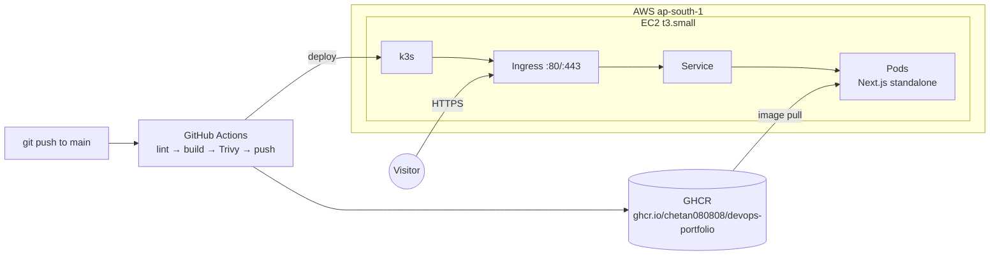

# Architecture

How this portfolio goes from a `git push` to a page in your browser. Each section says what the
piece is, why it's there, and how to try it locally. The doc grows with each Phase 7 checkpoint.



Status: **7a done** (container image). Cluster, pipeline and DNS boxes are the plan for 7b–7e.

## 1. Container image (7a)

**What:** a `Dockerfile` with three stages.

| Stage | Does | Why |
| --- | --- | --- |
| `deps` | `npm ci` from the lockfile | Cached until `package*.json` changes, so code edits don't reinstall. |
| `builder` | `next build` with `output: "standalone"` | Next traces exactly which files the server needs and copies them to `.next/standalone`. |
| `runner` | copies only the standalone server, `.next/static`, `public/` | No source, no dev deps, no compiler: ~60 MB of app on top of Node. |

**Runtime choices**

- **Base:** `node:24.21.0-alpine3.24`, pinned to an exact tag so builds are reproducible.
- **Non-root:** runs as the image's `node` user (uid 1000). npm/npx/yarn are removed from the
  runtime image: the server never installs anything.
- **Graceful shutdown:** `CMD ["node", "server.js"]` (exec form) makes Node PID 1, so Kubernetes'
  SIGTERM reaches it directly; Next finishes in-flight requests (measured stop: 1.4 s).
- **Health:** `GET /api/healthz` → `{"status":"ok","uptime":n}`, rendered per request (never
  prerendered), used by the Docker `HEALTHCHECK` and later by Kubernetes probes.
- **Rolling updates:** the build passes the commit SHA as `GIT_SHA`; `next.config.ts` uses it as
  both the build ID and the `deploymentId`. Every pod of one release serves the same asset names,
  and a browser still running the previous release gets a full reload instead of 404ing on chunks.
- **Writable path:** only `.next/cache` (the OG image may revalidate after 30 days). With a
  read-only root filesystem in Kubernetes this becomes an `emptyDir` mount.

**Measured (2026-10-12, local Docker Desktop):** image 334 MB uncompressed / 85 MB gzipped
(242 MB of it is the Node base image); Trivy: 0 HIGH/CRITICAL fixable vulnerabilities.

**Try it**

```bash
docker build -t devops-portfolio:local --build-arg GIT_SHA=$(git rev-parse --short HEAD) .
docker run --rm -p 3200:3000 devops-portfolio:local
curl localhost:3200/api/healthz
```
