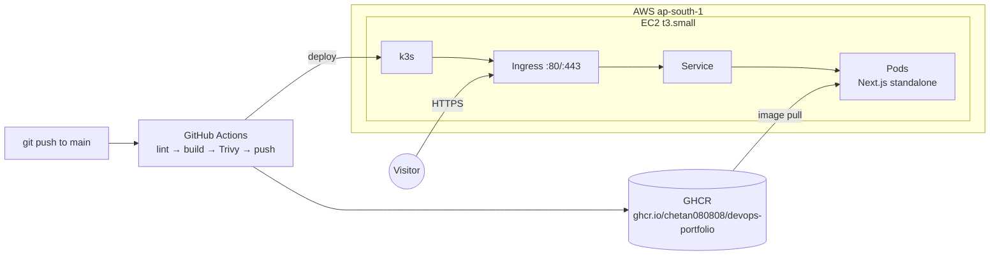

# Architecture

How this portfolio goes from a `git push` to a page in your browser. Each section says what the
piece is, why it's there, and how to try it locally. The doc grows with each Phase 7 checkpoint.



Status: **7a + 7b done** (container image; AWS server running k3s). Pipeline, app deploy and DNS are the plan for 7c–7e.

## 1. Container image (7a)

**What:** a `Dockerfile` with three stages.

| Stage | Does | Why |
| --- | --- | --- |
| `deps` | `npm ci` from the lockfile | Cached until `package*.json` changes, so code edits don't reinstall. |
| `builder` | `next build` with `output: "standalone"` | Next traces exactly which files the server needs and copies them to `.next/standalone`. |
| `runner` | copies only the standalone server, `.next/static`, `public/` | No source, no dev deps, no compiler: ~60 MB of app on top of Node. |

**Runtime choices**

- **Base:** `node:24.21.0-alpine3.24`, pinned to an exact tag so builds are reproducible.
- **Non-root:** runs as the image's `node` user (uid 1000). npm/npx/yarn are removed from the
  runtime image: the server never installs anything.
- **Graceful shutdown:** `CMD ["node", "server.js"]` (exec form) makes Node PID 1, so Kubernetes'
  SIGTERM reaches it directly; Next finishes in-flight requests (measured stop: 1.4 s).
- **Health:** `GET /api/healthz` → `{"status":"ok","uptime":n}`, rendered per request (never
  prerendered), used by the Docker `HEALTHCHECK` and later by Kubernetes probes.
- **Rolling updates:** the build passes the commit SHA as `GIT_SHA`; `next.config.ts` uses it as
  both the build ID and the `deploymentId`. Every pod of one release serves the same asset names,
  and a browser still running the previous release gets a full reload instead of 404ing on chunks.
- **Writable path:** only `.next/cache` (the OG image may revalidate after 30 days). With a
  read-only root filesystem in Kubernetes this becomes an `emptyDir` mount.

**Measured (2026-10-12, local Docker Desktop):** image 334 MB uncompressed / 85 MB gzipped
(242 MB of it is the Node base image); Trivy: 0 HIGH/CRITICAL fixable vulnerabilities.

**Try it**

```bash
docker build -t devops-portfolio:local --build-arg GIT_SHA=$(git rev-parse --short HEAD) .
docker run --rm -p 3200:3000 devops-portfolio:local
curl localhost:3200/api/healthz
```

## 2. Infrastructure on AWS (7b)

**What:** one EC2 server in Mumbai (`ap-south-1`) running k3s, a small but complete Kubernetes.
Everything is created by Terraform in `infra/terraform/`, in two stacks:

| Stack | Creates | Why separate |
| --- | --- | --- |
| `bootstrap` | S3 bucket for Terraform state; monthly cost budget with email alerts | The state bucket must exist before any other stack can store its state in it. Applied once. |
| `main` | VPC, subnet, internet gateway, security group, IAM role, EC2 instance, Elastic IP | The actual server. Changed whenever the infrastructure changes. |

**Terraform state:** kept in a private, encrypted, versioned S3 bucket (HTTPS only). Locking uses
S3's own lock file (`use_lockfile`), so no DynamoDB table is needed. Old state versions are kept
for 90 days, so a bad apply can be rolled back. The bucket name sits in a gitignored
`backend.hcl`: `terraform init -backend-config=backend.hcl`.

**Network:** own VPC `10.42.0.0/16` with one public subnet in one zone. There is a single server,
so more zones would only add cost. No NAT gateway, no VPC endpoints (both bill by the hour); the
server reaches the internet through the internet gateway.

**Security**

- **Inbound:** only 80 and 443. No SSH port, no Kubernetes API (6443) from the internet.
- **Outbound:** only 80 and 443 (package mirrors, image registries, AWS APIs).
- **Admin access:** AWS Systems Manager Session Manager. The server's only AWS permission is
  `AmazonSSMManagedInstanceCore`; a shell is `aws ssm start-session --target <instance-id>`,
  authenticated with AWS SSO and logged by AWS. No SSH keys exist.
- **Instance metadata:** IMDSv2 only, hop limit 1, so pods can't read the server's credentials.
- **Disk:** encrypted gp3, 20 GB. **Kubernetes secrets:** encrypted at rest (`--secrets-encryption`).

**k3s:** installed on first boot by `user-data.sh.tftpl`, pinned to `v1.36.5+k3s1` (both the
installer script and the binary). It ships Traefik (Ingress controller, listening on 80/443 through
k3s's ServiceLB) and metrics-server (feeds the HorizontalPodAutoscaler in 7c). Pods use
`10.52.0.0/16`, services `10.43.0.0/16`. Any change to the boot script rebuilds the server
(`user_data_replace_on_change`), because the script only runs once.

> **Lesson learned:** the first apply used the k3s default pod network `10.42.0.0/16`, the same
> range as the VPC. The node's own address was inside the pod network, and health checks to pods
> timed out. Fix: set `--cluster-cidr 10.52.0.0/16` and rebuild the server (1 replaced, Elastic IP
> kept). Always check that pod, service and VPC ranges don't overlap.

**Cost guardrail:** an AWS Budget of $28/month (before tax) emails at 90% actual, 100% actual and
100% forecast spend.

**Estimated cost (ap-south-1, on-demand, before tax)**

| Item | Per month |
| --- | --- |
| EC2 t3.small (CPU credits "standard": no surprise charges) | $16.35 |
| gp3 disk, 20 GB | $1.82 |
| Public IPv4 (Elastic IP) | $3.65 |
| State bucket, budget, SSM, VPC, IAM, first 100 GB out | ~$0 |
| **Total** | **≈ $21.82** |

**Measured after apply (2026-10-12):** node `Ready` about 2 minutes after boot; all system pods
running; idle memory 1.1 of 1.9 GiB used; from the internet, 80/443 answer (Traefik 404, nothing
deployed yet) and 22/6443/10250 are filtered.

**Try it**

```bash
cd infra/terraform/main
terraform init -backend-config=backend.hcl
terraform plan
aws ssm start-session --target "$(terraform output -raw instance_id)"
sudo k3s kubectl get nodes,pods -A
```
